# NEXUS DC · 3D Datacenter Digital Twin & O&M Cockpit

**可自由构建的 3D 机房 + 同一套数据的 2D 运维视图 + 真实设备接入。**

[](LICENSE)
[](https://threejs.org/)
[](#快速开始)
[](https://nodejs.org/)
[](https://kabaker915.github.io/nexus-dc/)
[](https://github.com/kabaker915/nexus-dc/actions/workflows/test.yml)

> **在线演示** → <https://kabaker915.github.io/nexus-dc/>
> 静态托管版本，3D 构建 / 2D 运维 / 模拟模式开箱可用；真实设备、SNMP/Redfish 采集与命令下发需要本地运行 `server.mjs`。

> **第一次使用？** 请直接看 **[📖 完整使用说明书（MANUAL.md）](MANUAL.md)** —— 安装启动、每个按钮、真实设备接入、API、快捷键、排障与安全边界都在里面。

> **English** — NEXUS DC is a browser-based digital twin for data centers. Build racks and devices in WebGL, wire ports at cable-level accuracy, then operate the same state from a Canvas 2D view: alarms, drills, CLI, config backup, audits, work orders, capacity forecast, and real-device telemetry over SSH / SNMP v2c / Redfish. It runs as native ES modules with **zero build step** and a local Node gateway.

基于 **three.js** 的可交互三维数据中心 + **Canvas 2D** 运维视图，并融合了 [NetDevOps-Toolbox-V1](https://github.com/lovekeven/NetDevOps-Toolbox-V1) 的多厂商运维能力：从空的机房地面开始，自由放置机柜、上架交换机 / 路由器 / 服务器 / 存储 / 配线架 / PDU，按端口级精度布线，然后用同一套状态做监控、告警、故障演练、CLI 终端、配置备份、批量巡检与智能诊断。

| 3D 机房 | 2D 平面 / 拓扑 |
| --- | --- |
| 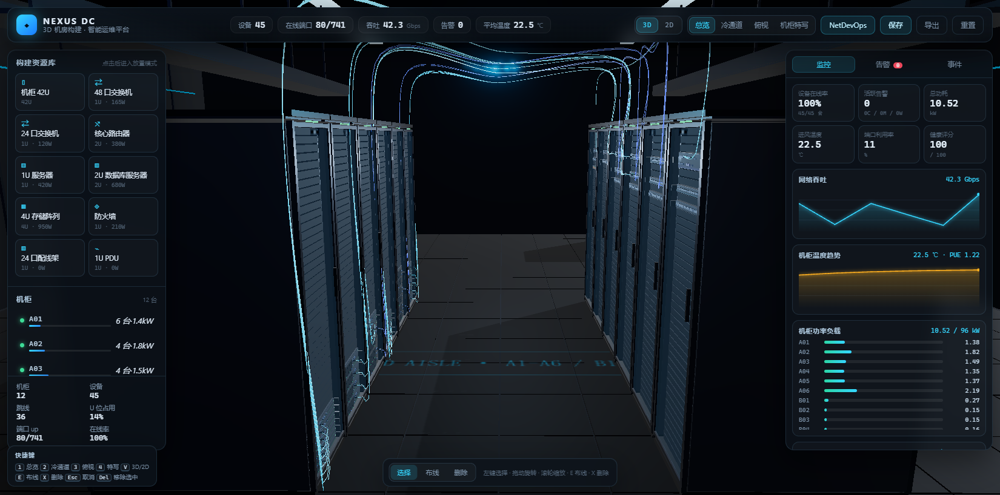 | 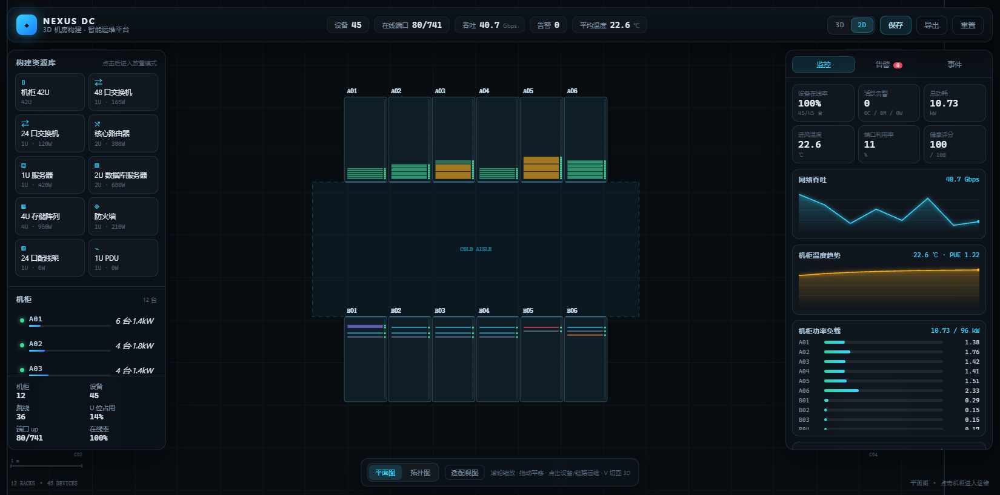 |
| 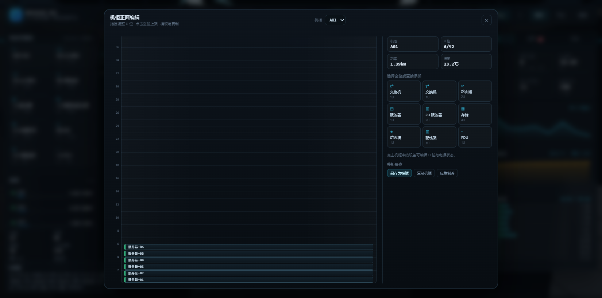 | 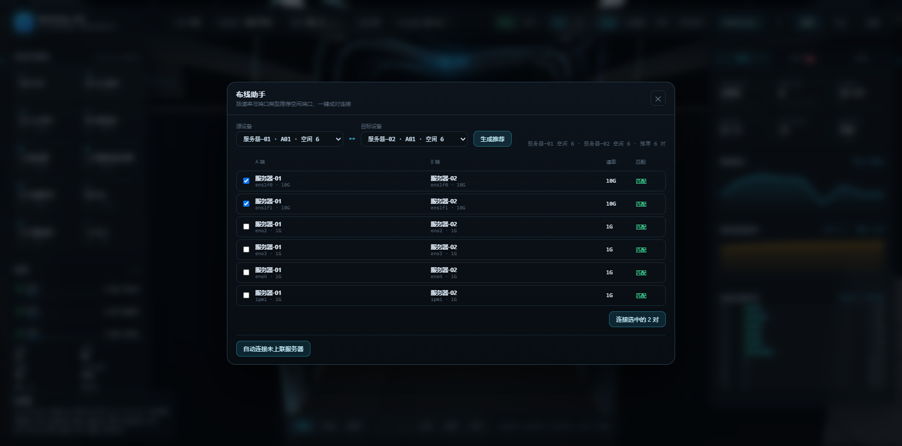 |

---

## 快速开始

```bash
git clone https://github.com/kabaker915/nexus-dc.git
cd nexus-dc
node server.mjs            # 或: PORT=8080 node server.mjs
# 浏览器打开 http://127.0.0.1:5199/
```

> 必须通过 HTTP 打开：页面使用 ES Module + import map 加载本地 `vendor/three`，`file://` 直接双击会被浏览器的模块 CORS 策略拦截。无需 npm install，无构建步骤。

### Windows 一键启动 / U 盘免安装

- 双击 **`启动.bat`**：优先使用 `runtime\node.exe`（便携 Node），启动本地服务并自动打开 <http://127.0.0.1:5199/>；关闭窗口即停止，或双击 **`停止服务.bat`**。
- 整个目录可直接拷到 U 盘 / 离线机器，**无需安装 Node**（`runtime/` 已内置）；删除 `runtime/` 则自动回退到系统 `node`。
- 端口被占用时，`启动.bat` 会直接打开已在运行的服务。

启动时自动生成一套 **2 排 × 6 机柜、45 台设备、36 条跳线** 的示例机房；之后的改动会存进 `localStorage`，刷新不丢，可随时「重置」回示例。

---

## 构建（Build）

| 能力 | 说明 |
| --- | --- |
| 自由建机房 | 「构建资源库」点击机柜 → 地面出现幽灵预览 → 落位；带 0.1 m 吸附与重叠检测 |
| 机柜上架 | 选设备 → 点机柜，自动寻找低位空闲 U 位；1U/2U/4U 混排，空位自动补盲板 |
| 端口级布线 | 布线模式下依次点两个端口，生成沿机柜侧边理线、走顶部桥架的悬链曲线；速率取两端较小值并决定线色 |
| 拆除 | 删除模式点设备 / 跳线 / 机柜；拆设备会连带清掉其跳线 |
| 视角 | 总览（冷通道走廊）/ 冷通道 / 俯视 / 机柜特写；OrbitControls 旋转、平移、缩放 |
| 机柜交互 | 开 / 关前门（带开门动画）、应急制冷、定位 |
| 持久化 | 自动存档 + 手动保存、导出布局 JSON |

**快捷键**：`1` 总览 `2` 冷通道 `3` 俯视 `4` 特写 · `V` 切换 3D/2D · `P` 第一人称巡检 · `F` 正面编辑 · `H` 热力 · `T` NetDevOps 工具箱 · `Shift` 多选 · `Ctrl+Z / Ctrl+Y` 撤销重做 · `Ctrl+A` 全选 · `E` 布线 · `X` 删除 · `Esc` 取消 · `Del` 拆除选中。

---

## 第一人称巡检

按 `P` 或底部工具栏「巡检」进入：`WASD` / 方向键移动，`Shift` 加速，拖拽环视，准星对准设备左键查看，`P` / `Esc` 退出。带机柜碰撞、视线高度 1.62 m、随身巡检头灯，退出后自动回到原机位。

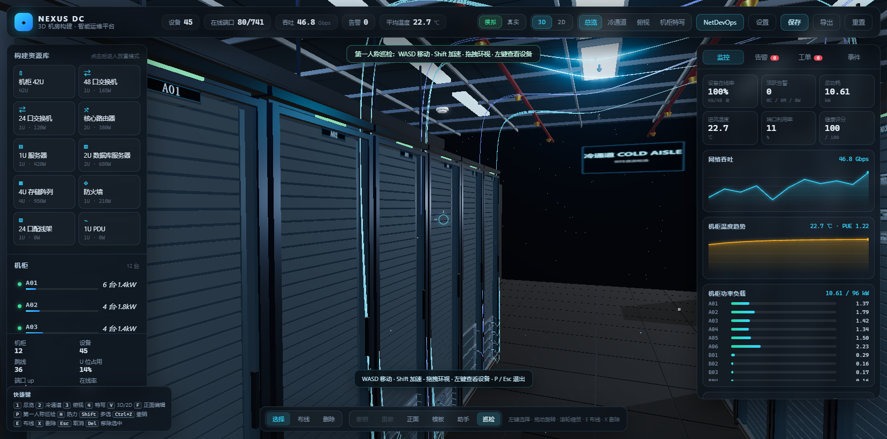

设备面板贴图升级为程序化机架面板（硬盘托架、端口矩阵、品牌/型号、状态灯、螺钉与噪点），近景下的 1U/2U/4U 细节更接近真实设备：

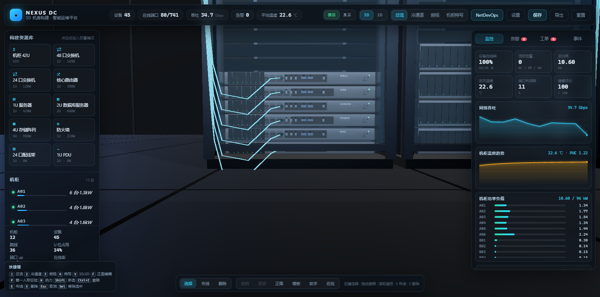

---

## 机房基础设施（v1.4）

建模包里的整机房内容已全部搬入：**吊顶与灯盘、UPS/电池/配电区、七氟丙烷气瓶与顶部喷淋、NOC 监控大屏（实时仪表盘）、门禁入口、备件货架/工具车、冷通道端门、尘埃与冷气粒子**。全部按我们的 13.2 × 11.2 m 机房重新落位，UPS/消防/货架/端门同时加入第一人称碰撞。

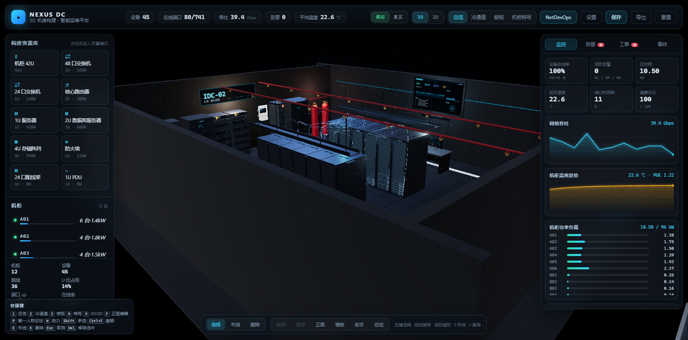

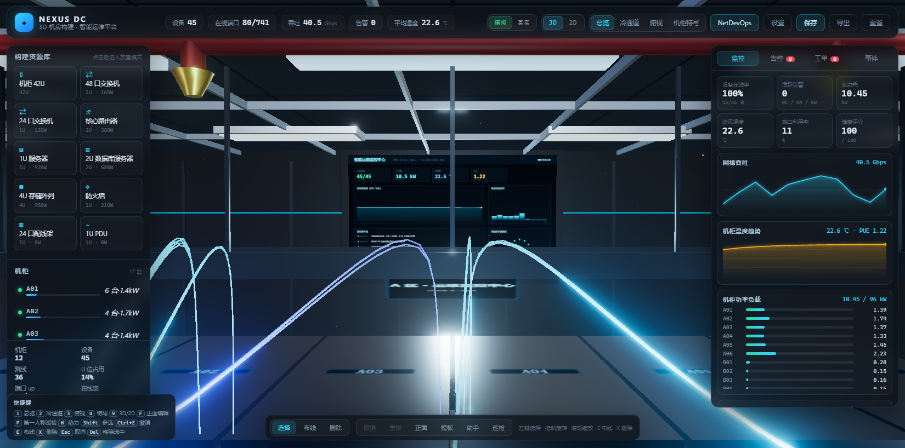

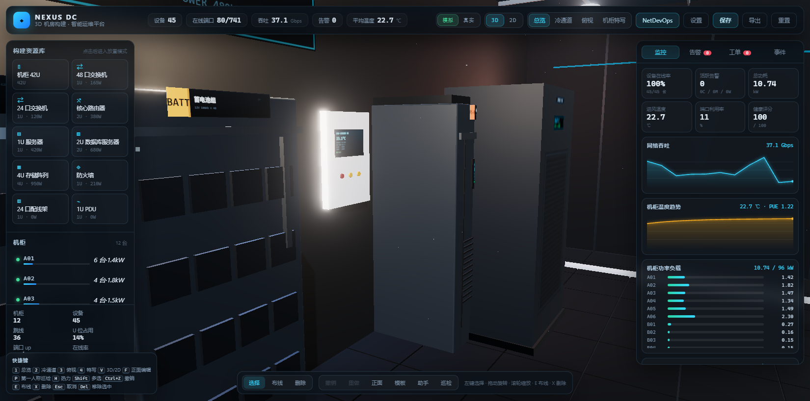

---

## 编辑效率与性能（P0）

| 能力 | 说明 |
| --- | --- |
| 撤销 / 重做 | 所有结构性编辑（放置、上架、移动、布线、删除、模板、批量）走快照历史，`Ctrl+Z / Ctrl+Y`，栈深 30，工具栏可点 |
| 多选 / 批量 | `Shift+点击`（3D 与 2D 均支持）增减选择，`Ctrl+A` 全选；右侧检查器变成批量面板，可批量断电 / 上电 / 重启 / 修复 / 开关门 / 制冷 / 删除 |
| 机柜正面编辑 | `F` 或工具栏「正面」打开 42U 正面视图：按 U 位渲染设备，拖拽调整 U 位、点空位上架、设备上移/下移、电源操作、整柜另存模板/复制 |
| 模板 / 复制 | 机柜模板（设备型号 + U 位）存本地，支持应用到一个机柜，或「新建机柜自动选位」；「复制机柜」整柜克隆 |
| 布线助手 | 选两台设备自动按速率 / 端口类型推荐端口对（1G 对 1G、10G 对 10G、交换机间优先 SFP+），勾选后批量布放；另有「自动连接未上联服务器」 |
| 画质档位 | 设置里三档：流畅（关阴影/Bloom、1×）、均衡（1024 阴影、半分辨率 Bloom）、画质（2048、全分辨率）；可显示 FPS / Draw Call HUD |
| 告警持久化 | 活跃告警与事件落 localStorage，刷新后保留；支持 Webhook 推送（企业微信等），经本机网关转发避免跨域，可发送测试消息 |
| 渲染优化 | LED 分帧刷新（每帧只更新 1/3 设备）、**全局端口实例池**（所有端口/指示灯各 1 个 InstancedMesh）、线缆按速率合并（36 条→2 个 draw call）、连接器合并为 1 个 InstancedMesh、阴影/Bloom 可关 |


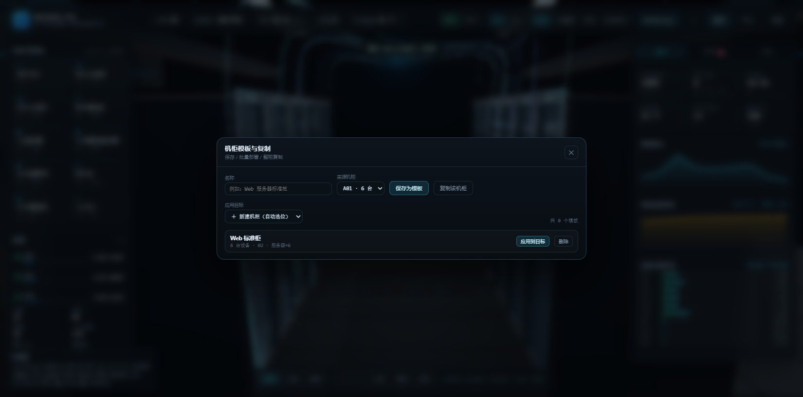

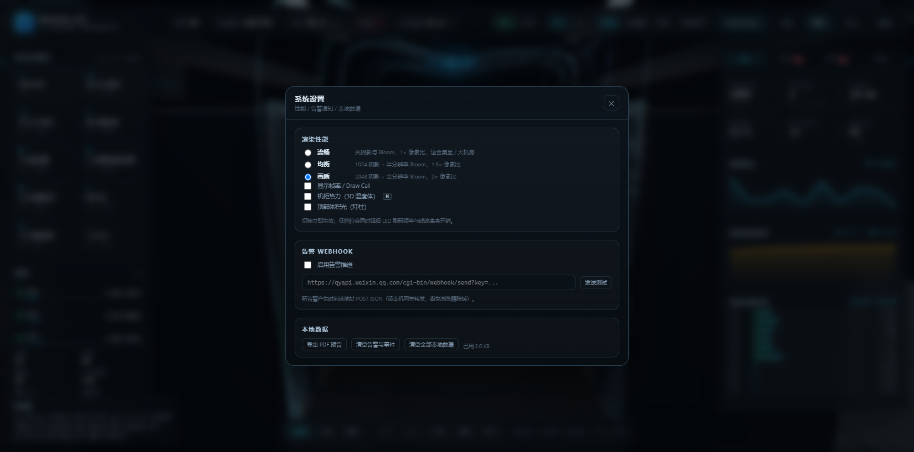

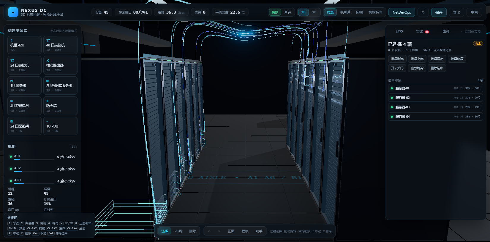

**运行时优化（v1.2）**：静态阴影只在地形/设备变化时重绘；空闲渲染降到 12 fps（交互 60 fps，标签页隐藏暂停）；UI 机柜列表按布局版本增量刷新、检查器 2 s 节流；静态资源 gzip + ETag/304，vendor 长缓存；网关增加 token + Host/Origin 校验，Webhook 默认仅 https/公网。

---

## 采集、拓扑、演练与报告（P1 / P2）

| 能力 | 说明 |
| --- | --- |
| SNMP v2c | 网关内置最小 BER 实现，GET `sysDescr / sysName / sysUpTime / hrProcessorLoad`；手动添加设备选 SNMP，默认 161/udp，超时与错误原样回显 |
| Redfish | `GET /redfish/v1/Systems` + `Chassis/*/Thermal`，采集电源状态、CPU 数、内存、最高温度、健康状态；默认 443/https，自签名证书可用，非 443 走 http |
| LLDP 自动拓扑 | 探测时额外采集 `display lldp neighbor-information`（Cisco 为 `show cdp neighbors detail`），「拓扑发现」把邻居名与机房 hostname / 设备名匹配，自动建立上联并重绘 2D 拓扑 |
| 时序库 | IndexedDB 每 5s 采样，保留 7 天，5 分钟分桶；仪表盘「24 小时趋势」+「容量预测」（U 位 / 功率 / 端口占比与预计用尽天数） |
| 工单 | 从告警卡片「工单」或设备「报修」创建，右侧「工单」页签管理：待处理 → 处理中 → 已完成、定位设备、删除；localStorage 持久化 |
| 演练剧本 | 市电中断 / 制冷失效 / 上联中断三套时间轴剧本，自动注入故障、产生告警并恢复，可随时中止 |
| 热力 / 体积光 | `H` 键或设置开关：机柜按温度着色（3D 半透明体），顶部灯柱体积光 |
| PDF 报告 | 设置 →「导出 PDF 报告」生成可打印报告（KPI、机柜、容量、告警、设备清单），浏览器打印/另存为 PDF |

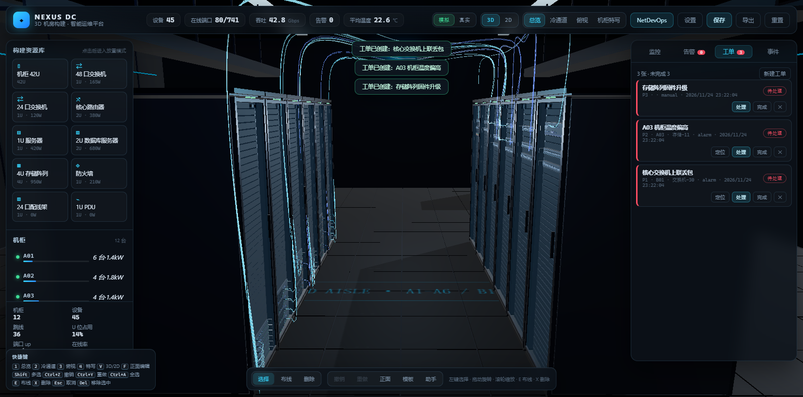

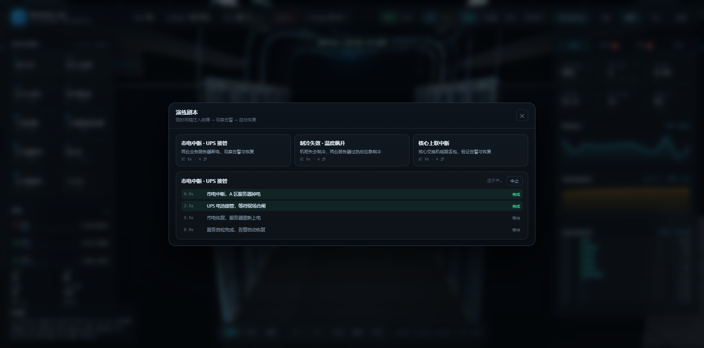

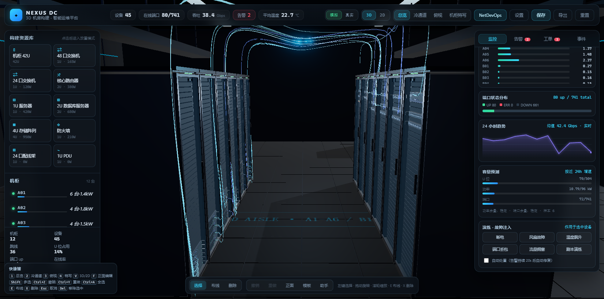

> 真实设备支持 SSH / SNMP v2c / Redfish 三种接入协议，并可一键做 LLDP 拓扑发现：

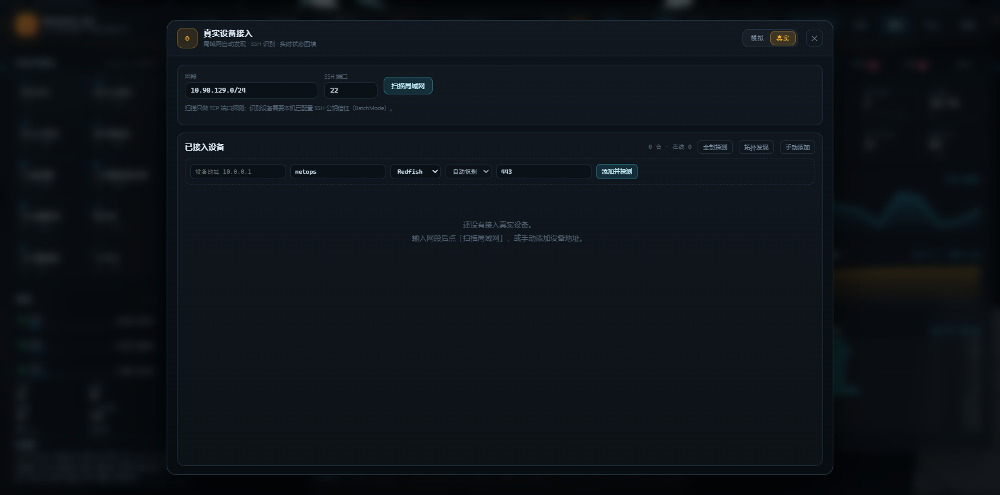

> 设置页新增热力、体积光与报告入口：


> **类型基座**：`jsconfig.json` + `src/types.d.ts` 已为 `state / Device / Rack / Cable / RealDevice / WorkOrder` 等核心对象建立类型契约，编辑器可获得补全与跳转；项目仍以零构建的原生 ESM 运行，后续可按模块逐个加 `// @ts-check` 完成渐进式 TypeScript 迁移（完整迁移需要引入构建链，属于独立重构）。

---

## 2D 运维视图（与 3D 同一套运维）

顶栏 **3D / 2D** 一键切换。2D 不是静态示意图：它读取同一个 `state` 与 `sim`，点击设备同样打开右侧检查器，告警、故障注入、重启/断电/修复、端口切换全部可用。

### 平面图


- 按真实尺寸绘制机房地面与机柜（0.6 × 1.2 m），0.1 m 网格
- 机柜内按 U 位绘制已上架设备（颜色区分交换机 / 服务器 / 存储 / 防火墙…）
- 实时显示机柜功率、温度、设备数；告警机柜红色呼吸灯，选中机柜高亮
- 点击机柜 → 右侧检查器（设备上架图、开门、应急制冷、移除…）
- 滚轮缩放、拖动平移、比例尺、CRAC 精密空调位置

### 拓扑图

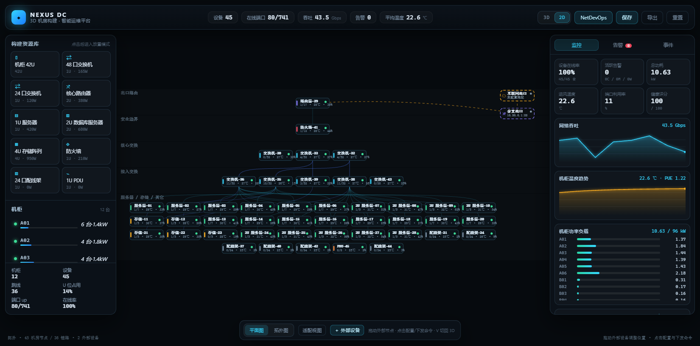

- 自动分层：出口路由 → 安全边界 → 核心交换 → 接入交换 → 服务器 / 存储
- 每条跳线是一条贝塞尔链路，颜色对应速率（1G / 10G / 25G / 100G）
- 节点显示名称、端口 up 数、温度、CPU、状态灯；告警节点红色描边
- 悬停节点高亮其链路并显示详情；点击节点 / 链路 → 检查器执行运维
- 拓扑随设备与跳线变化自动重建，支持缩放平移

3D 里选中设备，切到 2D 会同步选中；2D 里点「定位」也会把 3D 相机飞过去（反之亦然）。

---

## 真实 / 模拟模式

顶栏 **模拟 / 真实** 一键切换（快捷键 `R`）。模拟模式跑内置遥测引擎；真实模式自动发现局域网设备、SSH 识别，并把真实状态回填到数字孪生。

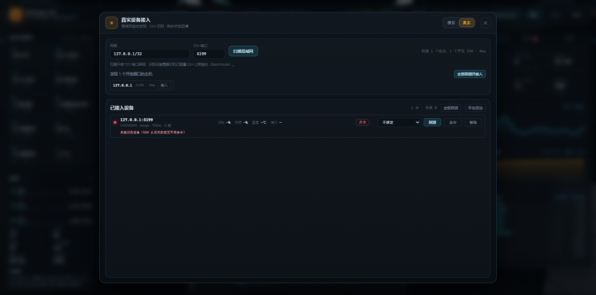

| 能力 | 实现 |
| --- | --- |
| 网段建议 | `GET /api/netinfo` 读取本机网卡，跳过 WSL / VMware 等虚拟网卡，给出 `/24` 建议 |
| 自动发现 | `POST /api/discover` 并发 TCP 探测（≤254 地址、32 并发、可调超时），返回开放 SSH 的主机与 RTT |
| 设备识别 | `POST /api/probe` 以 BatchMode SSH 依次尝试 Comware / IOS / Linux 命令集，识别 H3C / 华为 / Cisco / Linux 与型号 |
| 状态采集 | 解析 CPU、内存、温度、端口 up/down，同时保留版本行与原始回显 |
| 接入展示 | 设备进入「真实设备」列表，并在 2D 拓扑中生成外部节点，状态点随探测结果变化 |
| 回填孪生 | 绑定到机房模型设备后，真实模式下用真实 CPU/内存/温度/端口数覆盖仿真值；切回模拟立即恢复 |
| 轮询 | 真实模式每 15 s 刷新在线设备（最多 4 台），也可手动「全部探测」 |

**安全边界**：网关只监听 `127.0.0.1`，API 仅接受本机请求；SSH 使用 `BatchMode`（公钥 / ssh-agent），不保存密码；命令走 exec 通道，不拼接 shell。

> 真实识别要求设备可达且已配置公钥信任；未配置时设备行会显示「认证失败 / 未能识别」，不影响模拟模式。

---

## 拓扑搭建与外接设备下发

2D 拓扑图是可编辑的：底部 **＋ 外部设备** 添加节点，拖动调整位置，点击节点配置上联与连接参数，链路以虚线接回机房设备。外部节点与位置随布局一起持久化。

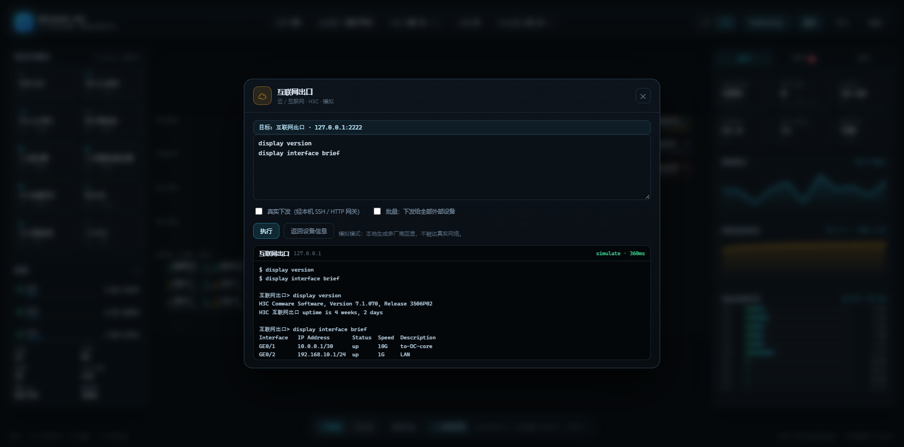

**外接设备**支持 5 种类型（路由器 / 交换机 / 防火墙 / 主机 / 云），每个节点带厂商、管理地址、端口、协议、用户名与上联节点；支持把它们接成链（云 → 出口路由 → 机房核心），并联动机房里的真实设备节点。

**命令下发**有三种适配器：

| 模式 | 行为 |
| --- | --- |
| 模拟 | 浏览器内按厂商生成 CLI 回显，不触达网络，适合演练与教学 |
| SSH（本机网关） | `POST /api/dispatch` → 本机 `ssh`（BatchMode，密钥 / ssh-agent 认证），每条命令一个 exec 通道，12 s 超时 |
| HTTP API | `POST http://host:port/api/exec`，JSON `{commands}`，适配带 RESTCONF / 自研 agent 的设备 |

- 弹窗内可一次下发多行命令，支持 **批量：发给全部外部设备**，逐节点回显耗时与结果
- 真实模式必须勾选二次确认；网关只监听 `127.0.0.1`，限制命令条数与长度，不拼接 shell
- 节点状态（未探测 / 模拟 / 连通 / 故障）实时回写到拓扑图

> 真实下发需要目标设备可达且已配置 SSH 公钥信任；没有可用凭据时会返回网关错误，模拟模式不受影响。

---

## NetDevOps 工具箱（融合 NetDevOps-Toolbox-V1）

顶栏 **NetDevOps** 按钮、快捷键 `T`，或设备检查器里的「终端 / 配置 / 诊断」进入。窗口内是五个工作区，全部读取实时仿真状态，操作会反作用于 3D/2D 场景。

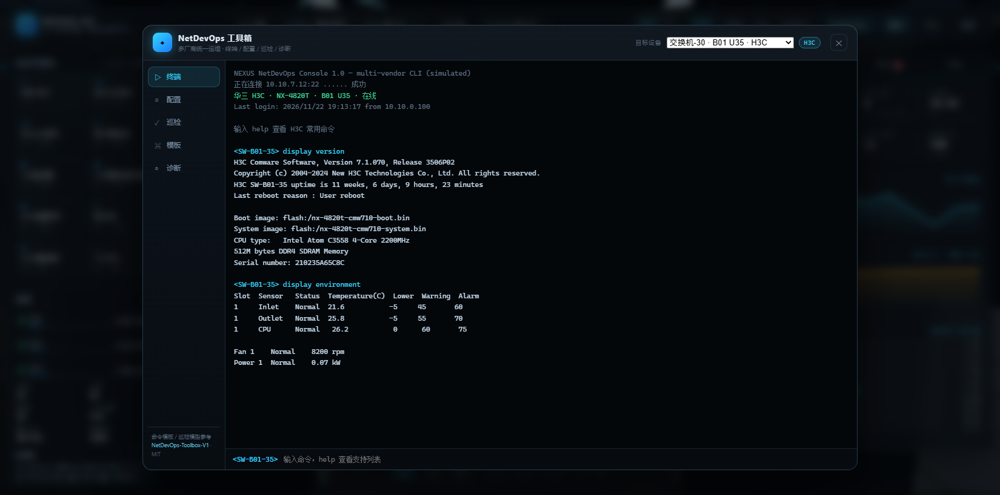

| 上游项目能力 | 本项目落地方式 |
| --- | --- |
| Web SSH 终端（零客户端） | 浏览器内多厂商 CLI 模拟：H3C Comware / 华为 VRP / Cisco IOS / Linux，命令输出由实时端口、路由、温度、邻居推导 |
| 多厂商命令模板 | 直接沿用上游 `config/command_templates.json` 的分类与命令（系统/接口/VLAN/路由/协议/性能/安全），点击即在该设备执行 |
| 设备健康检查 | 全量巡检：在线、CPU、内存、温度、风扇、端口错误、链路一致性、机柜功率 8 类规则，0–100 评分，可导出 Markdown 报告 |
| 配置备份 | 一键备份全网配置快照（localStorage，保留 6 份），与当前配置做行级 diff，+/- 高亮 |
| AI 智能分析 | 本地规则引擎：把告警、指标、拓扑邻居关联成「现象 / 证据 / 可能原因 / 处置动作 / 排查命令」，不调用外部大模型 |
| 拓扑可视化 | 已由 3D 机房与 2D 拓扑承担，工具箱复用同一份链路数据 |

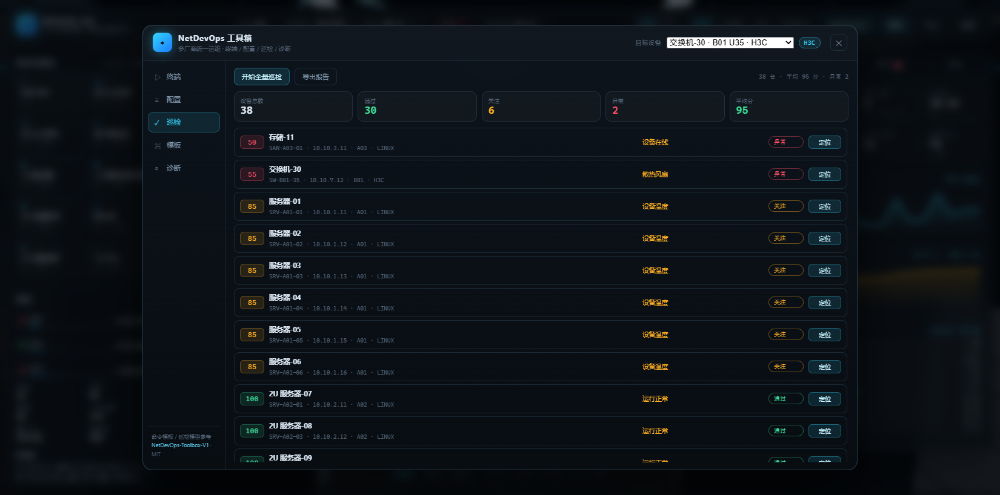

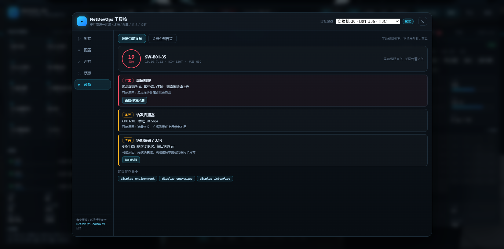

**与场景联动**：诊断里的「远程上电 / 修复 / 应急处置」会直接调用机房运维动作；巡检行与诊断对象可一键在 3D 中定位；切换 3D/2D 选中会同步工具箱目标设备。

**厂商分布**：交换机 H3C、路由器/防火墙 Huawei、服务器/存储 Linux（示例默认，可按需扩展）。

> 命令模板与巡检规则参考 MIT 许可的 [NetDevOps-Toolbox-V1](https://github.com/lovekeven/NetDevOps-Toolbox-V1)；本实现不包含其 Python 后端、SNMP/SSH 采集与邮件服务，设备侧数据来自本项目的仿真引擎。

---

## 仿真设备与端口

每台设备都是程序化建模，端口是真实几何体（`InstancedMesh`，可射线拾取），灯位独立的实例颜色：

| 设备 | 规格 | 端口 |
| --- | --- | --- |
| NX-4820T 交换机 | 1U | 48×GE RJ45 + 4×10GE SFP+ |
| NX-2420T 交换机 | 1U | 24×GE + 4×10GE SFP+ |
| NX-R9600 路由器 | 2U | 8×25GE + 4×100GE QSFP28 + 4×MGMT + Console |
| R450-G6 服务器 | 1U | 8×2.5" 盘位 + 4×GE + 2×10GE + IPMI |
| R850-G6 服务器 | 2U | 12×3.5" 盘位 + 2×GE + 2×10GE + IPMI |
| S8400 存储 | 4U | 24×3.5" 盘位 + 双控 4×25GE + MGMT |
| FW-3200 防火墙 | 1U | 8×GE + 4×10GE |
| PP-24K 配线架 | 1U | 24×Cat6A 模块 |
| PDU-8C13 | 1U | 8×C13 分路计量 |

细节：面板丝印 / 品牌 / 通风槽纹理、硬盘位与指示灯、状态灯、后部风扇与电源、机柜 U 位刻度、顶部健康灯条、竖直理线器、盲板。

---

## 运维（Ops）

- **1 Hz 遥测**：每台设备有 CPU / 内存 / 温度 / 功率 / 吞吐曲线；端口有 up/down/error、速率、利用率、收发流量、CRC 计数。
- **业务流打通**：流量只在「两端端口 up 且已布线」的链路上产生，交换机汇聚后进入核心、再到路由器，吞吐与端口利用率都由此驱动。
- **热力与功率**：机柜功率 = 设备功耗之和；进风温度随负载、风扇故障、过热注入变化；超过 32 ℃ 重要告警、38 ℃ 严重告警；功率超过额定 90% 提示。
- **告警**：分级（严重 / 重要 / 提示）、自动去重、自动恢复、可确认、可一键处置（重启 / 上电 / 修复 / 应急制冷）。
- **故障演练**：断电、风扇故障、温度飙升、端口丢包、流量拥塞；开启「自动处置」后，持续 20 s 的告警会被自愈引擎处理。
- **操作**：设备重启（真实 7 s 重启窗口）、断电/上电、隔离、故障修复、端口 admin up/down、机柜开门、应急制冷。
- **健康度**：按告警级别与温度计算 0–100 分，联动机柜顶部灯条与列表状态点。

---

## 仪表盘

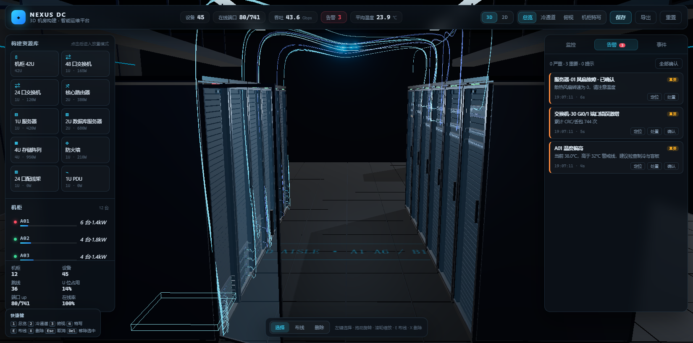

- KPI：在线率、活跃告警、总功耗、进风温度、端口利用率、健康评分。
- 图表：吞吐 / 温度趋势（Canvas 手绘，无图表库）、机柜功率负载条、端口状态分布条。
- 告警列表：级别、描述、持续时长、定位、处置、确认。
- 事件流：所有操作与告警的审计日志。

---

## 代码结构

```
nexus-dc/
├── index.html            # 页面骨架 + import map + 错误兜底
├── styles.css            # 深色玻璃拟态 UI
├── server.mjs            # 零依赖静态服务器
├── src/
│   ├── main.js           # 场景/相机/后期、拾取、放置、布线、存档、主循环、3D/2D 切换
│   ├── flat.js           # 2D 平面图 + 逻辑拓扑（Canvas 2D，共享状态与运维）
│   ├── extnet.js         # 外部/边缘节点模型、模拟回显、命令网关客户端
│   ├── extui.js          # 外部设备配置与命令下发弹窗
│   ├── realnet.js        # 真实设备发现/探测/解析与孪生回填
│   ├── realui.js         # 真实设备接入控制台（扫描/识别/绑定）
│   ├── history.js        # 快照式撤销/重做
│   ├── frontedit.js      # 机柜正面 2D 编辑器（U 位拖拽/上架）
│   ├── templates.js      # 机柜模板保存/应用/复制
│   ├── cabling.js        # 布线助手（端口推荐/批量连接）
│   ├── settings.js       # 画质档位、Webhook、本地数据
│   ├── portpool.js       # 全局端口 / LED 实例池
│   ├── analytics.js      # IndexedDB 时序、容量预测、PDF/打印报告
│   ├── workorders.js     # 工单流转
│   ├── playbook.js       # 演练剧本
│   ├── thermal.js        # 机柜热力与体积光
│   ├── walk.js           # 第一人称巡检（机柜碰撞 / 头灯 / 准星拾取）
│   ├── paneltex.js       # 程序化设备面板贴图库（融合自 DCIM 建模包）
│   ├── props.js          # 机房基础设施（UPS / 消防 / NOC / 吊顶 / 粒子）
│   ├── roompack.js       # 建模包机房构建器（按本机房尺寸适配）
│   ├── types.d.ts        # 核心对象类型契约（jsconfig.json 提供编辑器检查）
│   ├── toolbox.js        # NetDevOps 工具箱窗口（终端/配置/巡检/模板/诊断）
│   ├── netdevops/
│   │   ├── vendors.js    # 厂商身份、主机名、管理 IP、接口命名、VLAN 规划
│   │   ├── templates.js  # 多厂商命令模板（改编自 NetDevOps-Toolbox-V1，MIT）
│   │   ├── cli.js        # 模拟 CLI：display/show/ping/save/reboot 等
│   │   ├── config.js     # 多厂商配置生成 + 行级 diff
│   │   └── audit.js      # 健康巡检与本地诊断规则
│   ├── world.js          # 房间、地板、墙、桥架、CRAC、灯光
│   ├── models.js         # 机柜与设备程序化建模、LED/盲板刷新
│   ├── catalog.js        # 设备目录、端口布局、端口配色
│   ├── cables.js         # 桥架走线曲线与线缆材质
│   ├── sim.js            # 遥测、告警、故障注入、处置动作
│   ├── ui.js             # 仪表盘、检查器、告警/事件、Canvas 图表
│   ├── materials.js      # 共享材质与几何
│   └── util.js           # 单位、工具、Canvas 纹理
├── vendor/three/         # three r187（本地化，离线可用）
└── tools/                # 无头浏览器截图 / 端到端脚本（开发用）
```

坐标约定：1 世界单位 = 1 米；42U 机柜 2.0 m 高、0.6×1.2 m；19" 设备宽 0.4826 m；1U = 44.45 mm。

---

## 开发工具

```bash
node tools/cdp.mjs http://127.0.0.1:5199/ tools/shot.png 5000     # 无头截图（Edge）
node tools/cdp.mjs http://127.0.0.1:5199/ tools/e2e.png 5000 @e2e-scenario.js
node tools/cdp.mjs http://127.0.0.1:5199/ tools/f2d.png 5000 @flat-scenario.js
node tools/cdp.mjs http://127.0.0.1:5199/ tools/tb.png 5000 @toolbox-scenario.js
node tools/cdp.mjs http://127.0.0.1:5199/ tools/ext.png 5000 @ext-scenario.js
node tools/cdp.mjs http://127.0.0.1:5199/ tools/real.png 5000 @real-scenario.js
node tools/cdp.mjs http://127.0.0.1:5199/ tools/p0p1.png 5000 @p0p1-scenario.js
node tools/cdp.mjs http://127.0.0.1:5199/ tools/batch.png 5000 @batch-render-scenario.js
node tools/cdp.mjs http://127.0.0.1:5199/ tools/p2.png 5000 @p2-scenario.js
node tools/cdp.mjs http://127.0.0.1:5199/ tools/walk.png 5000 @walk-scenario.js
node tools/cdp.mjs http://127.0.0.1:5199/ tools/viewmode.png 5000 @viewmode-scenario.js
node tools/service-test.mjs       # SNMP / Redfish 网关 + LLDP 解析（含本地 mock 设备）
node tools/parse-test.mjs        # 真实设备回显解析（H3C / 华为 / Cisco / Linux）
```

> **CI**：`.github/workflows/test.yml` 已启用（`tests`），每次 push 自动执行语法检查、厂商回显解析、SNMP/Redfish/LLDP 与网关安全/缓存测试；模板另存于 [`docs/ci-workflow.yml`](docs/ci-workflow.yml) 方便 fork 后复用。

端到端脚本会模拟真实点击，验证「放机柜 → 上架 → 布线 → 断电告警 → 修复 → 存盘」、2D 的「平面图选机柜 → 拓扑图选节点 → 注入故障 → 处置 → 回到 3D」、工具箱的「CLI 命令 → 配置生成 → 快照 → 巡检 → 模板执行 → 诊断」、外接设备的「选中节点 → 改配置 → 模拟下发 → 真实网关失败回显 → 新增节点 + 上联 → 持久化」、真实模式的「切到真实 → 扫描环回 → 接入 → 识别失败回显 → 绑定孪生 → 切回模拟清理」，以及 P0/P1 的「撤销重做 → 多选批量 → 正面编辑上架 → 模板保存应用 → 布线助手连接 → 画质档位 → 告警持久化」。

---

## 说明与边界

- 模拟模式的遥测为**仿真数据**；真实模式通过本机 SSH / SNMP / Redfish 网关采集 CPU/内存/温度/端口，未接入的指标仍由仿真引擎提供。两种模式互不影响，可随时切换。
- 布线走机柜正面到理线器、再上顶部桥架，是可视化取舍；真实数据中心以背部走线为主。
- 单场景建议不超过 ~60 台机柜 / 3000 端口；LED 分帧刷新（默认 160 ms），端口与线缆均已合批。
- SNMP 目前是 **v2c GET**（sysDescr / sysName / sysUpTime / hrProcessorLoad），不含 walk、trap 与 v3；Redfish 为只读采集，需要设备开启 Redfish 并提供账号（自签名证书放行）。
- LLDP 拓扑依赖设备回显格式（Comware / Cisco CDP 已适配，Huawei 表格式做了通用匹配）；匹配依据是主机名 / 设备名，命名不规范时可能连不上。
- 3D 设备标签仍为几何标签，未做 SDF 字形图集；TypeScript 采用 `jsconfig + types.d.ts` 的渐进基座，完整迁移需引入构建链。
- 第三方许可见 [docs/THIRD-PARTY.md](docs/THIRD-PARTY.md)（NetDevOps-Toolbox-V1 与 three.js 均为 MIT）。

---

## 贡献与许可

- 欢迎 Issue / PR：先在本地 `node server.mjs` 跑起来，再执行 `tools/` 下的场景脚本做回归。
- 代码以 **MIT** 许可发布，见 [LICENSE](LICENSE)；three.js 与 NetDevOps-Toolbox-V1 的许可见 [docs/THIRD-PARTY.md](docs/THIRD-PARTY.md)。
- 安全问题请通过 GitHub Security Advisory 私下报告，不要在 Issue 里贴真实设备口令或内网地址。

## 作者

**kabaker915** · [github.com/kabaker915](https://github.com/kabaker915)

如果这个项目对你有帮助，欢迎点一个 ⭐ Star。
